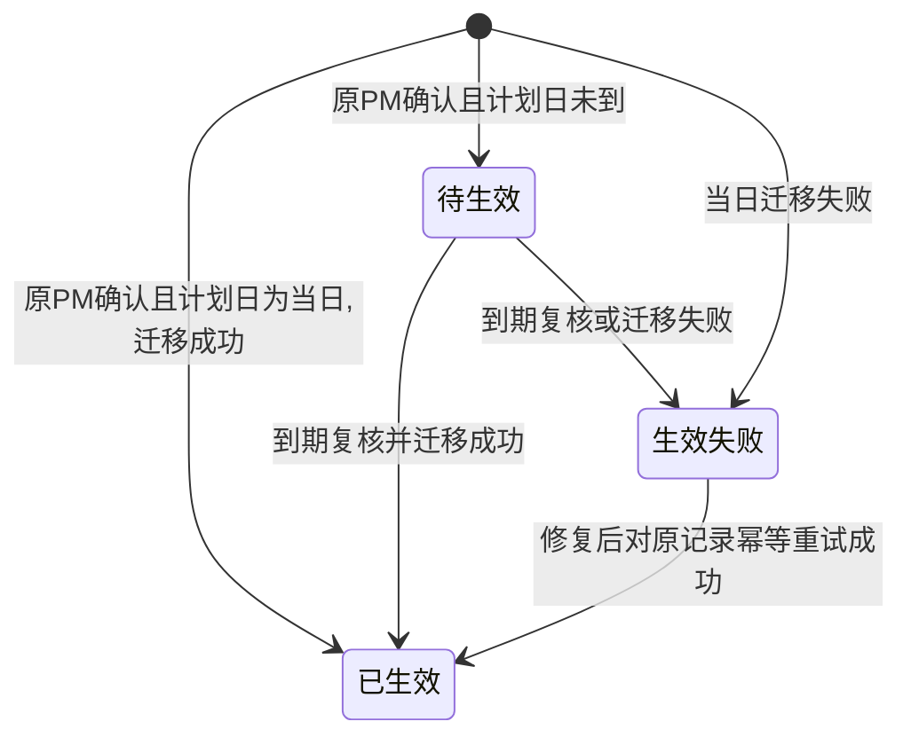

# FLOW-06 M08-city-handover

- 原始行：1499
- 原始最近标题：交接申请字段与流程
- 迁移方式：Mermaid block mechanical copy
- 当前定位：Current Product Flow；DEC-143 仅允许原负责 PM 发起普通交接，DEC-204 取消区域总监审批；M08 的分配/直接调整是独立受控动作

> Historical / Replaced：本 Flow 旧图包含区域总监/admin 普通交接发起、待审批、已驳回、已撤回和审批回调失败。当前普通交接仅原负责 PM 发起，不提供接收、审批或撤回；旧图只用于 Git/Archive 追溯。

> DEC-209 补充：普通 PM 地市交接/直接调整的影响确认与生效迁移包含责任地市全部未落选商机，并记录来源责任变更。任一适用任务、项目或商机迁移失败，整体保持原值；已落选商机和历史月份目标不改写。详见 [`prd-workspace/current/modules/M08-region.md`](../modules/M08-region.md) → “4.9 PM 地市责任与商机同步”。

> Historical / Replaced（2026-10-30，DEC-237）：2026-10-28 责任解析补充：地市交接/直接调整继续维护一个地市默认 PM；新建客户负责人解析另查 M08 的“地市＋集团/行业”责任规则，集团优先、行业其次、默认 PM 兜底。该规则不迁移存量客户，平台师资合作商机继续使用生态责任分支。详见 [`prd-workspace/current/modules/M08-region.md`](../modules/M08-region.md) → §4.4.1。

## 行业中心启用与三级责任变更（DEC-237）

1. M06 建立运营中心部门与有效主管/PM，M08 在启用前配置行业及全国责任分配，不提前切换存量。
2. admin/市场副总在编辑配置中补齐接收安排，确认保存即生效（无独立启用按钮）；逐客户验证：唯一行业中心 → 省级公司指定PM或默认中心总监；市县客户公司 > 中心集团 > 中心地市 PM。
3. 未分配客户、冲突、接收人或操作者失效：列出必要失败原因并阻止，原中心和全部业务责任保持。
4. 校验通过：启用及存量客户/关键人、适用维系、六阶段普通项目、未落选普通商机整体交接；任一步失败全部回滚。完成后原地理中心不再拥有该行业当前经营数据。
5. 两类中心客户/集团分配新增、变更、启停同样立即交接存量；停用回退下一层，失败配置与业务保持。地市交接只迁移未被高优先级覆盖的本中心客户。
6. 已完成任务、维系历史、项目终态/资料/快照、已落选商机原负责人、历史业绩、目标及生态独立责任保持。客户当前范围影响所有列表/计数/直接访问。

精确 Owner：[`M08`](../modules/M08-region.md) → §4.4.1–4.4.2；Acceptance：[`M08`](../acceptance/M08.md) → AC-F003-27–30、AC-F004-22–24。

## 省级客户指定PM（2026-11-02，DEC-238）

省级客户先匹配本中心客户公司指定PM，再回退中心总监；集团/地市不匹配省级。省公司分配新增、更换、停用按最终负责人整体交接适用业务，无有效接收人或迁移失败保持原值。PM可创建并执行本人指定省公司业务，总监仅监管指定PM业务；总监停用/更换及区域责任交接排除已指定PM省公司，PM停用由公司分配组接收。六阶段普通项目、未落选商机和适用任务按原交接边界处理，历史、终态、快照及业绩目标保持。精确Owner：`prd-workspace/current/modules/M08-region.md` → §4.4.1；Decision：`prd-workspace/decisions/DEC-238-省级客户可指定PM承担完整经营责任.md` →“当前决定”。

## 集团按省分流

admin/市场副总选择集团及业务责任省份 → 查看自动匹配的该省地理中心及立即交接提示 → 保存时重算命中省/市/县客户及有效接收人 → 任一未分配或迁移失败整组保持；成功后客户/适用任务KPI/六阶段普通项目/未落选商机交接，当前权限和统计同步。停用或修改按新规则重新解析，未配置省份仍行业中心；历史和目标保持。精确定义见 `prd-workspace/current/modules/M08-region.md` →“集团按业务责任省份分流（DEC-240）”、AC-M08-DEC240。

## 无交接事项取消关联

有权配置者取消PM关联或admin/市场副总移出省份 → 按实际责任集合检查关键人、未完成任务/KPI、六阶段普通项目、未落选普通商机及未结束交接 → 无事项直接进入解绑确认，不选接收人；省份同时说明连带清除该省责任配置 → 提交复核权限/映射/事项，成功后待分配或按原下一层解析，最后一省解除回待配置。存在交接事项则沿原交接/接收人流程；多省分别判定、整次保存原子生效。主数据、其他省责任和历史保持。Owner：`prd-workspace/current/modules/M08-region.md` §4.4.3；DEC-242“当前决定”；AC-F003-33、AC-F004-25。

## 客户直接划转与配置保存生效

admin/市场副总选择已生效行业运营中心 → 客户归属与划转 / 划转客户 → 下拉多选来源客户 → 直接选任意有效地理运营中心 → 核对默认接收人或指定本中心PM → 查看来源/接收责任及交接事项 → 确认保存并交接 → 提交重新校验来源仍为已生效行业中心、权限、配置和接收人 → 成功整批立即生效，失败/取消全部保持。地理区域中心不显示划转客户按钮且不得发起，已接收的客户亦不得再次划转；旧入口及直接调用同样阻断。未选客户不变；集团按省分流独立保留。行业中心编辑配置列出未分配客户，补齐后保存即生效，不再单独启用。详见DEC-244及AC-M08-DEC244。
