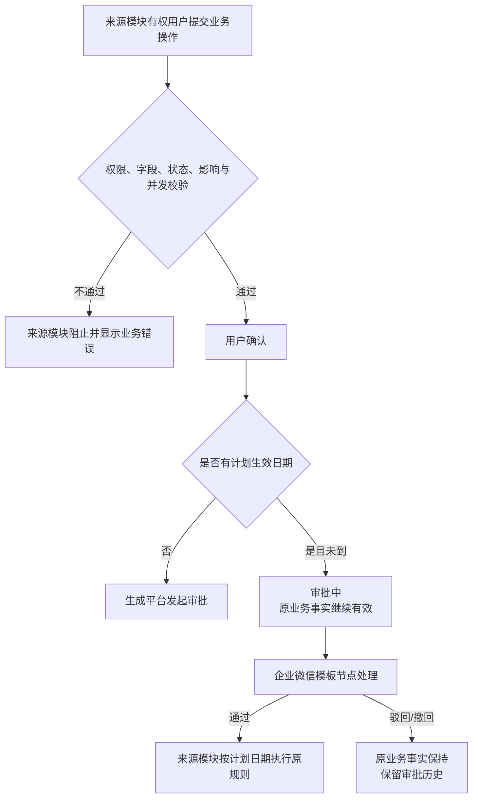

# FLOW-09 M04 approval lifecycle

## Current Boundary

M04 审批中心为 `NOT REVIEWED / NOT STARTED / DEFERRED`。本地 Working Demo 表达平台发起与企业微信同步的未评审工作范围；已确认进入审批的来源模块提交后保持原状态，企业微信通过后才执行原业务规则：

本节的页面入口、通用发起表单和员工绑定是当前确认的Demo表达；具体模板、接口实联、同步时效及撤回/驳回后的重提仍需评审和企业微信样单核验。历史版本可通过 Git/Archive 用于追溯，但不是 Current Product Rule。

精确来源：`DEC-204《当前业务操作取消审批并由来源模块生效》`，见 [`prd-workspace/decisions/DEC-204-当前业务操作取消审批并由来源模块生效.md`](../../decisions/DEC-204-当前业务操作取消审批并由来源模块生效.md) → “决策”第 1-12 项。

## 已确认的企业微信专项流程边界

来源：[`M04 审批中心`](../modules/M04-approval.md) → §3；[`DEC-259`](../../decisions/DEC-259-企业微信员工绑定与通用审批接入.md) →“当前决定”。模块仍延期、未评审、未研发；本节同时约束Working Demo的可见链路，不代表企业微信已经真实联通。

1. HR/admin核对已有两边员工并维护一对一绑定，不覆盖组织账号；未绑定/冲突禁止发起。
2. admin配置接入，审批事项、模板字段及路线在企业微信维护；发起人先选择当前可发起事项，平台按事项动态展示字段，已映射业务字段使用平台下拉选项。审批人和抄送人由模板路线预设，不在平台发起表单选择。Working Demo提供独立一级菜单“审批中心”和“发起审批”表单。
3. 平台填写并以绑定员工身份发起；只建立与本平台发起企业微信单的对应关系，不导入企业微信原生单。提交成功后进入“我发起的”，详情显示处理位置为企业微信。
4. 本人按申请/审批/抄送关系在平台查看，admin核查同步集合。同意/驳回/撤回统一在企业微信执行：当前有权审批人同意/驳回，申请人按企业微信允许条件撤回；平台不提供三项直接处理操作，admin不代审批。
5. 平台同步企业微信处理后确认的真实过程和结果，失败不显示成功、重复通知不重复建单或覆盖历史。具体补查和同步时效待定义，不自动新增跳转入口。
6. 撤回/驳回后按实际企业微信规则修改重提；当前未确认原单/新单方式。审批变化不等同财务记账或收付款。

已确认进入审批的业务为：关键人停用、任务延期/暂停/取消、已开始项目中止、地市责任交接、销售指标调整；项目取消、关键人恢复及未列事项继续按来源模块直接生效。
