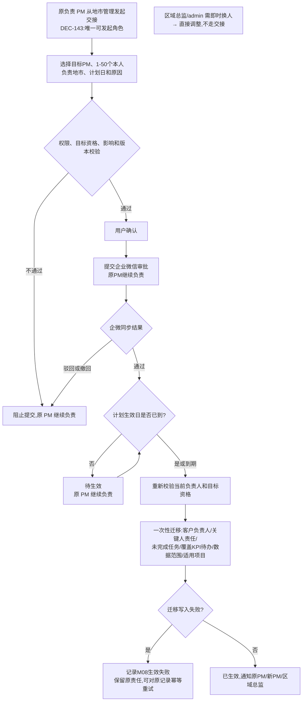

# FLOW-10 M08-city-handover-approval

- 原始行：2551
- 原始最近标题：F2 地市负责人交接
- 迁移方式：Mermaid block mechanical copy
- 当前定位：Current Product Flow；文件名为历史兼容标识。原负责 PM 从“地市管理”发起普通交接，提交企微审批，通过后按计划生效；总监直接调整无需审批（DEC-143/DEC-173/DEC-259）

平台不提供同意、驳回、撤回或目标PM接收；审批和撤回沿企微模板同步。区域总监在主管范围内直接调整，二次确认后立即生效，无需审批。
