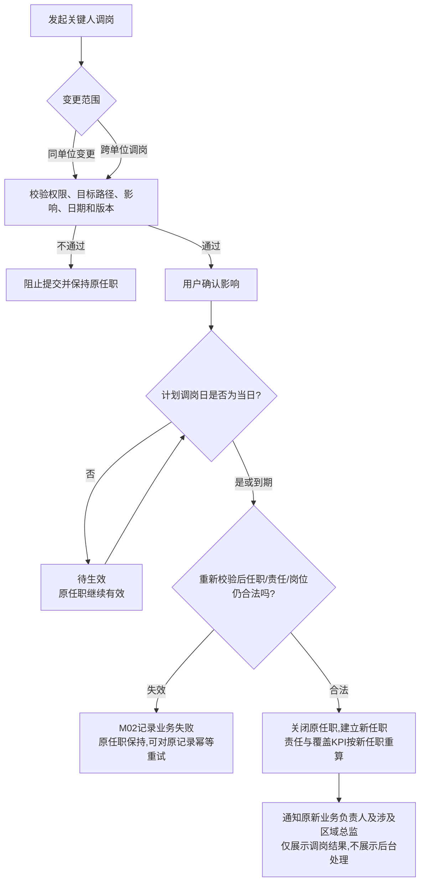

# FLOW-11 M02-key-contact-transfer-approval

- 原始行：2568
- 原始最近标题：F3 关键人调岗
- 迁移方式：Mermaid block mechanical copy
- 当前定位：Current Product Flow；文件名为历史兼容标识。DEC-204 已取消关键人调岗的目标 PM 接收和所有上级审批，当前只表达直接/待生效业务流程。

> Historical / Replaced：本文件旧机械块曾包含目标 PM 接收、上级审批、驳回和`已通过-业务处理失败`。这些语义已被 DEC-204 替代；旧表达只用于 Git/Archive 追溯，不再作为 Current Rule。

## 区域总监发起范围（2026-11-18，DEC-257）

总监从当前主管中心内本人/PM负责客户发起同单位或跨单位调岗（含指定PM省公司） → 校验原客户唯一中心与当前主管关系、账号和原操作权限 → 沿原全量正常目标组织、影响确认和计划日规则 → 生效后按新责任收敛权限。PM责任不因代操作改为总监，实际操作者留痕总监；无关中心、失权或事实变化拒绝。合法调岗产生的任务关闭/迁移仍按原规则，不能借任务入口手工代完成/延期/暂停/取消PM任务。Owner `prd-workspace/current/modules/M02-customer.md` → §4.6/§5.1；验收 `prd-workspace/current/acceptance/M02.md` → AC-M02-DIRECTOR-PM-20261118。
