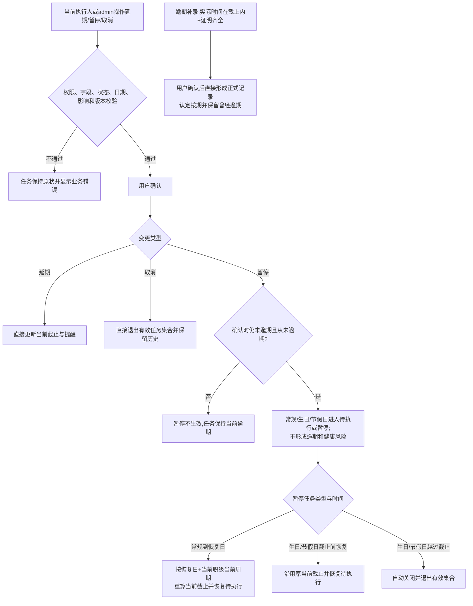

# FLOW-12 M03-task-exception-approval

- 原始行：2588
- 原始最近标题：F4 任务异常与逾期补录
- 迁移方式：Mermaid block mechanical copy
- 当前定位：Current Product Flow；文件名为历史兼容标识。DEC-204 已取消任务异常与逾期补录审批，当前只表达 M03 校验确认后的直接生效流程。

> Historical / Replaced：本文件旧 Current 内容包含区域总监、市场副总或总裁审批，以及`已通过-业务处理失败`。这些语义已被 DEC-204 替代；旧内容只用于 Git/Archive 追溯。

## PM任务禁止主管代办（2026-11-18，DEC-257）

总监查看主管中心PM任务 → 只读，无完成/补录/补完成/延期/暂停/取消入口；直接调用同样拒绝。总监从客户经营/维系管理录本人记录或从商机跟进同步 → 不匹配或关联完成PM任务 → 保存实际总监本人记录，PM任务状态/截止及续期不变；伪造关联或失权整次拒绝。总监本人任务和独立有效admin原资格保持。Owner `prd-workspace/current/modules/M03-maintenance.md` → §2.1“总监记录与PM任务边界（DEC-257）”；验收 `prd-workspace/current/acceptance/M03.md` → AC-M03-DIRECTOR-PM-20261118。
