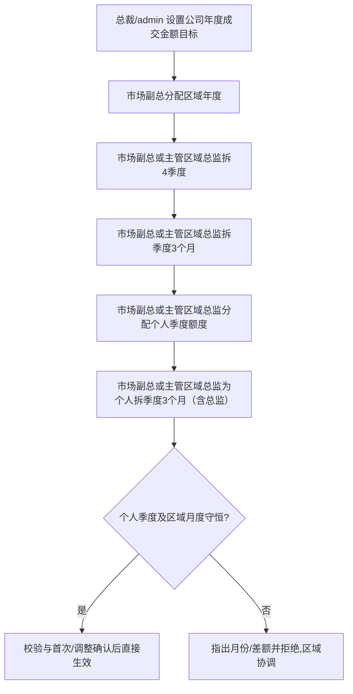
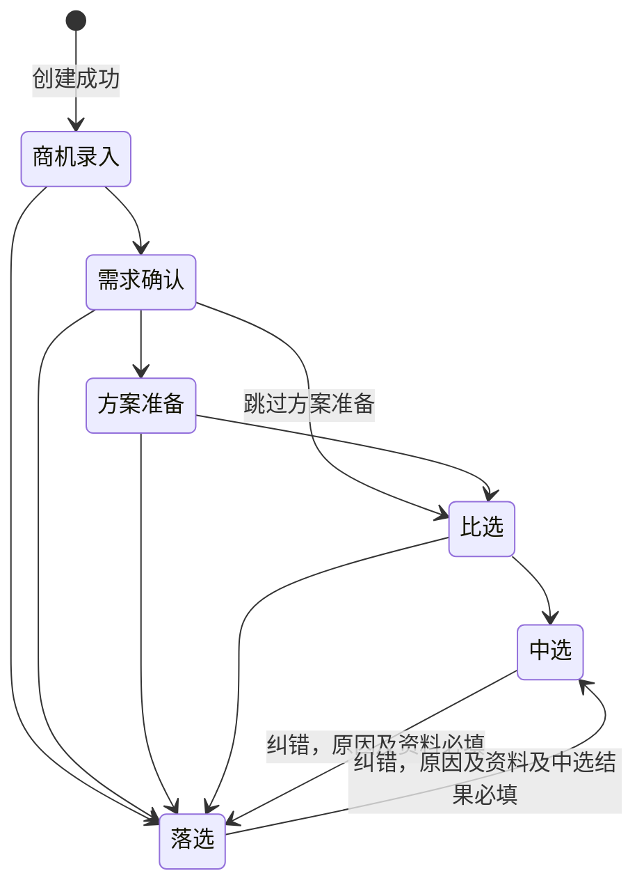
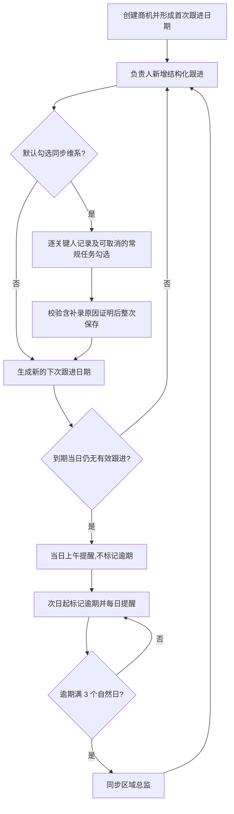
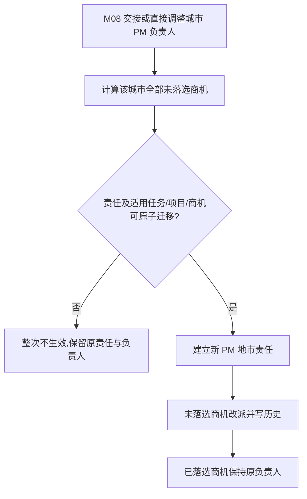

# FLOW-17：M12 销售与商机管理

- 状态：Current
- Owner：M12
- Decision：DEC-223（成交金额考核）、DEC-081、DEC-194、DEC-204、DEC-211（接收与文件交付）、DEC-210（支撑角色）、DEC-209（替代 DEC-206/208 的角色与地市责任部分）

## 工作台销售统计（DEC-222）

有权用户进入M01业务工作台 → 查看销售周期目标及当前快照 → 年/季/月筛选更新周期指标/趋势；商机概况选择运营中心、阶段/类型分析、联动条件、数量/金额 → 同一有权集合更新环形图/合计/分类占比。统计只读，不向商机列表传递条件；业务操作由销售管理首项“商机列表”和既有销售指标页进入。独立销售仪表盘取消，旧页面直接访问不再提供销售内容。精确规则见 `prd-workspace/current/modules/M12-sales-opportunity.md` §7 和 `prd-workspace/current/modules/M01-dashboard.md` §4.10。

按角色：总裁看公司达成/商机推进；副总看全国周期及区域达成；总监看主管区域，主周期同步本人业绩与各人完成、区域卡独立筛选；PM看本人目标/商机/趋势，取消本人跟进事项卡片，商机概况独占该行，跟进仍在既有商机详情维护；其余单独角色无销售区，admin业务原布局保持。精确集合与展示规则见 `prd-workspace/current/modules/M12-sales-opportunity.md` → §7.1.3。

## 销售目标建立

目标为成交金额（含税，元），按中选日期和中选成交金额计算完成；数量只作过程观察。总裁区域目标对比使用独立年/季/月和中心筛选，仅更新本卡；Owner完整口径见 `prd-workspace/current/modules/M12-sales-opportunity.md` → §6.1/6.2及§7.1.2。

当前流程依据 [`DEC-224`](../../decisions/DEC-224-销售目标年度逐级分配与个人拆月.md) → “2026-10-16 个人月份统一由区域总监分配”，完整规则见 `prd-workspace/current/modules/M12-sales-opportunity.md` → §4、§6.1/6.2/6.3。上级可先发布，下级未分配不补0；区域月度目标先定，个人不能改季度额度或区域月度。总裁/admin覆盖，副总全部中心区域年度/季度/月度及个人季度/月份协调，总监主管区域季度/月度及个人季度/月份协调，PM仅只读查看本人目标及业绩；分配弹窗显示实时余额并校验单项上限；首次免原因，点击确认分配校验后直接生效，修改已有目标仍需原因和二次确认；个人月度管理入口复用区域协调以分配或调整，精确余额/原因规则见上述Owner §6.3及AC-M12-57/58；历史月不改写，无审批/通知。公司与区域年度/季度按对应已分配目标读取，个人年度汇总季度。

个人季度分配展示：进入原弹窗 → 人员一行，季度与3个月并列，单位统一、历史月只读 → 调整时实时查看原余额并按条件填写原因 → 原确认分配/保存本层调整流程；表头/操作区固定、人员表内滚动。关闭取消无写入，不另增步骤。Owner M12 §6.3、AC-M12-PERSON-QUARTER-UI-20261116。

## 商机创建、编辑与推进

2026-10-22确认：商机阶段原“方案支撑”称“方案准备”，旧事实/时间和历史不变、统一展示新名。创建不选择支撑、不创建请求 → 正常推进至方案准备可直接推进，也可选“同时发起方案支撑请求”（默认否） → 选择是时复用人员多选、需求及截止必填 → 校验成功同次推进并逐人创建待响应请求；失败、取消、失效、重复不部分写入。其他目标阶段及纠错不附带支撑；进入方案准备/比选/中选后可在详情追加，商机录入/需求确认/落选禁止发起；既有请求仍按原规则查看处理。请求不自动推进阶段；阶段除下述方案准备→比选批量关闭及原落选关闭外，不自动接收/验收请求或检查请求完成。Owner：`prd-workspace/current/modules/M12-sales-opportunity.md` → §8.2/9/10；验收AC-M12-09/10/27/30/90。

有权用户查看商机列表 → 列表不展示“是否方案支撑”和“交付进度”，阶段后直接为客户单位 → 通过原详情按钮进入商机详情，在方案支撑Tab沿原权限查看、发起或处理支撑请求及交付记录；请求有无或状态变化均不恢复列表两列。其他列表字段、范围、筛选、排序和分页保持。完整定义见 `prd-workspace/current/modules/M12-sales-opportunity.md` → §8.1“列表”；验收见 `prd-workspace/current/acceptance/M12.md` → AC-M12-64。

- “线索”只描述商机录入、需求确认等早期商机，不是独立对象或状态。
- 有权操作者打开“推进商机阶段” → 查看只读“当前阶段” → 在“推进至阶段”选择正常后续／回退／中选落选互转目标 → 自动判为正常推进或纠错 → 纠错必填原因与资料、目标结果字段仍必填 → 确认推进／确认纠错；同阶段及非法向前目标不可选且直接提交拒绝，无独立纠错入口。
- 正常推进目标为需求确认 → 可选多选“需求附件（选填）” → 未选亦可确认推进、无需额外说明；选文件则按Shared03统一规范校验/上传 → 全部成功才同次写入阶段与该条历史附件 → 通过原阶段历史按原商机/附件权限查看下载。失败、取消、失效/重复不部分写入，切换其他目标不带入草稿；纠错原必填材料不变。Owner：`prd-workspace/current/modules/M12-sales-opportunity.md` → §9；验收AC-M12-91。
- 商机负责人按客户业务责任自动匹配并只读：市/区县客户匹配唯一地市 PM 负责人，省级客户匹配当前区域总监；无唯一有效匹配时阻止创建。
- PM 只可按本人当前 PM 责任地市创建本人负责商机；区域总监可创建并直接推进本人主管区域的省级商机，监管的其他商机只读监管，不可单独手工改派。
- 商机关键人从所选客户当前有效关键人中至少 1 人可搜索多选，保存时重新校验。
- 落选前仅允许编辑已确认字段；客户单位、商机类型不可改，负责人只随客户责任关系变化；中选后预估金额只读。成功编辑写入变更历史并更新最近更新时间。
- 进入中选填写中选日期、`成交金额（含税，元）`及说明/证明附件；中选仍允许跟进。
- 进入落选填写落选原因、竞争对手、复盘说明及证明附件；落选后停止推进和新增跟进。
- 当前 M12 不进入已签约；合同与财务能力须由未来独立 Current 产品链接管。

## 跟进

## 方案支撑

方案支撑仅在上述正常推进或详情允许阶段由有权商机负责人/admin发起；既有请求处理不受新发起阶段限制。商机负责人向一名或多名在职、账号有效且具有商机支撑角色的员工发起（可与 PM 等兼任），按员工 ID 去重；每次必须填写支撑需求和交付截止时间，每名支撑人员独立经历待响应、进行中、已交付、已关闭。被指派人从`方案支撑`处理本人请求，可进入被指派商机的精简只读背景页，无 Tab 或支撑请求表格，按 M12 §10“支撑视角商机详情”展示；列表与详情可接收当前明确的待响应请求，先按 M12 §10“接收二次确认”弹窗核对，最终确认才进入进行中；取消或关闭不流转，失效/重复确认不写入；详情接收后停留原页且按钮消失；文件提交返回方案支撑，无过程提交；最终填写文件说明并上传1-9个附件，全部成功后成为已交付，负责人按 M12 §10“方案验收二次确认”核对后最终确认关闭，取消不流转、失效/重复不写入；admin 从`方案支撑管理`查看公司全量并以真实身份代操作，但不作为候选或受理人。不判断或发送回应超时消息，不展示回应超时；每条请求通过“历程”查看本人的独立支撑流程，权限沿用原请求范围，交付截止不引入新的逾期自动处理。

支撑列表按 M12 §10“支撑列表剩余时间与筛选”展示实时剩余时间；待响应/进行中按截止时间升序，超时未交付优先，已交付/已关闭置后。用户先通过`全部`、`待响应`、`进行中`、`已交付`、`已关闭`五个状态 Tab 切换列表，再按商机名称、客户单位和交付截止日期范围组合筛选、重置；状态 Tab 与其他条件按 AND 组合，切换 Tab、筛选和重置返回第一页，详情返回保留当前 Tab 和已应用筛选。支撑接收、文件提交与权限沿用上述规则，不新增超时自动处理。

已交付内容不在支撑列表内铺开，通过操作栏“查看交付”打开最新交付的文件说明和附件列表，逐个查看或下载；补充中保留上次交付可查，新交付成功后整体更新，历次交付说明和附件在该请求“历程”中保留且可查看/下载。具体附件限制和失败原子性见 M12 §10“支撑文件”。

已交付 → 商机负责人点击“要求补充” → 弹窗填写必填“补充或修改说明” → 最终提交并复核 → 记录意见/操作人/时间、回到进行中 → 支撑人员在本人历程读取要求 → 重新提交说明与附件 → 已交付 → 负责人再次验收或要求补充 → 点击确认接收 → 二次确认弹窗核对商机与支撑人员/关闭后果 → 最终确认复核账号、权限、对象、指派、状态及本次交付 → 当前请求已关闭；取消不流转，失效/重复不写入。取消/空白/失权/重复提交不改变事实；原截止与历次成果保留，无新状态或消息。历程按记录时间倒序（最新在上，同时间按实际发生顺序倒序）独立展示每人的发起、接收、交付、补充、重新交付、关闭及附件，关闭保留来源上下文；完整交互及历史附件边界见 `prd-workspace/current/modules/M12-sales-opportunity.md` → §10“补充要求与支撑历程”、AC-M12-60/61/62。

## 销售指标查看

- 登录默认当前自然年/季度/月。管理目标变更记录在单层弹窗按目标年度查询，默认全部有权记录；中心/人员/层级选择后查询，重置回全部与第一页，不跟随背景中心/季度；关闭保持背景上下文。类型、增减额与生效方式及候选/失权规则见 `prd-workspace/current/modules/M12-sales-opportunity.md` → §6.3、AC-M12-TARGET-UX-20261116。公司调整未完成时管理分配区明确待生效，本人只读页季度/月份/业绩统一有效值；完成或取消遵循 §6.4、AC-M12-TARGET-EFFECTIVE-20261116。

- 市场副总在管理页选择年度/季度/中心，查看全部中心个人季度/月度目标；右上角目标变更记录默认按所选目标年度包含全部个人层级，不自动跟随背景中心/季度，弹窗可按本节上述条件查询。可复用管理页原入口维护全部中心区域年/季/月及个人季/月（含PM及区域总监），原因/确认、守恒及历史月保护保持；公司年度设置及整轮完成/取消仍仅总裁/admin。依据 DEC-252“当前决定”及 `prd-workspace/current/modules/M12-sales-opportunity.md` → §4/6.3；验收 AC-M12-VP-TARGET-20261116。

- PM和区域总监通过工作台`我的销售指标`区只读查看本人季度及月度额度，不拆月或调整目标，继续查看本人月度成交金额目标、成交金额、差额、完成率和本人调整历史；不查看公司、其他区域或其他PM目标。
- PM默认模板提供工作台本人指标查看，独立个人菜单移除、旧地址返回工作台；总监保留原销售指标分配菜单，不再从管理页切独立个人页。本人年/季/月独立选择，变更记录点击弹窗，按稳定员工ID只展示本人，区域监管/趋势筛选各自保持。完整规则见 `prd-workspace/current/modules/M12-sales-opportunity.md` → §6.3；验收AC-M12-PERSONAL-WORKBENCH-20261116。

## PM 地市责任变化

## 失败保护

- 必填缺失、范围变化、关键人失效或非法阶段请求不改变当前事实。
- 并发阶段请求只有基于最新版本的合法请求生效。
- 指标校验、权限或并发失败不覆盖最近生效版本。
- 消息失败不回滚商机、跟进或支撑事实。
- 越权访问统一返回 403 且不泄露对象是否存在。

## 本轮生命周期、目标调整与纠错（2026-10-14）

- 正常推进由负责人手动判断，可跳过方案准备；进入中选/落选需材料及说明；错误事实由负责人在统一“推进阶段”选择回退／中选落选互转，提交原因及资料，按纠正结果重算业绩并保留历史；不允许同阶段日期金额修改或非法向前纠错。原主链只代表正常操作，落选不阻止纠错。准确入口见 M12 Owner §9及AC-M12-65/66。
- 公司已有年度目标调整 → 原设置入口填写新目标/原因并确认 → 本轮差额处理 → 市场副总或主管区域总监沿授权链路保存下级待生效调整 → 受影响链路全部守恒且零余额 → 总裁/admin完成 → 公司/下级整体生效；完成前统计读旧值。取消二次确认后全部未生效内容作废；同年下一轮只能在完成/取消后开始。初次分配与其他独立调整仍按§6.2，当前公司差额过程替代上方即时生效路径；准确入口 M12 §6.4及AC-M12-69/70/71。
- 支撑待响应可撤回；负责人/admin主动停止需原因及二次确认；落选关闭全部未关闭支撑，原因商机落选；关闭/撤回后如需新增请求。停用管理者指定有效接替人 → 确认前复核全部接替人 → 账号先停用 → 系统自动交接原请求且保留文件/状态/完整历程；缺接替阻止提交，后续交接失败账号仍停用、成功项保留、失败项继续处理。准确入口 M12 §10、M06“员工停用”及AC-M12-67/68。

## 交接异常与目标承接（2026-10-15）

- 移除支撑角色 → 复核全部未关闭请求与接替人及唯一性 → 原请求交接成功 → 撤销角色；失败全部保持。新增支撑也校验同商机同员工未关闭唯一性。
- 原负责人已失效/不匹配的落选恢复 → admin上传材料说明 → 匹配客户当前唯一有效PM/总监 → 同次恢复及责任记录；无匹配阻断。
- 停用/实际交出某区域全部责任 → 从实际接替人指定一人承接个人目标 → 本月未完成差额/未来已分配全额，季月守恒 → 目标随对应责任成功生效 → 领导原个人季度入口可联合协调季/月；部分地市交接不自动转目标。历史目标及原中选归属保持。完整规则M12 §6.5及AC-M12-72至77。

## 销售复盘确认补充（2026-10-15）

- 销售开始前由管理流程完成商机所属区域当年全链目标拆分（年度→区域→季度/月度→个人季度/月度），无需其他区域全部完成；不新增系统业务入口拦截，原目标/交接/历史月校验保持。见 `prd-workspace/current/modules/M12-sales-opportunity.md` → §6.2，AC-M12-78。
- 员工目标已转出且停用 → 该季个人额度为0的原空月保持未分配 → 后续公司调整不强制补0 → 其他有效链路完整且全层守恒才整体生效；不能向停用人员新增额度。见 `prd-workspace/current/modules/M12-sales-opportunity.md` → §6.4，AC-M12-79。
- 中选→落选或回退 → 统一推进弹窗自动纠错 → 必填原因／资料及目标结果 → 撤销有效中选业绩并重算；落选→中选须填正确日期／金额 → 重算对应周期，不重复累计；原真实落选历史不追溯改写，不提供保持落选修改原日期／金额。见 `prd-workspace/current/modules/M12-sales-opportunity.md` → §9“商机纠错”，AC-M12-66/80。

## 平台师资合作商机与无关键人

生态员进入新建商机 → 类型固定平台师资合作、负责人本人 → 选择正常且已填写合作课酬的平台公司（0有效，不取PM客户表；资格见M11 §8.3“平台公司管理”），不维护关键人；平台停用或清空合作课酬只退出新建候选；提交复核最新资格、已有商机仍可维护；admin代建先选该类型及有效生态员。普通培训/AI商机若客户无有效关键人，有M02原创建权限者打开客户固定的创建表单 → 成功返回保留草稿并刷新候选；无权限者联系客户负责人或管理员补充，再选择关键人。提交复核类型/对应客户源/当前员工与负责人，关键人仅校验普通类型 → 原商机录入阶段。本人沿既有跟进/支撑/推进；中选事件仅计公司。地区交接排除此类型；生态停用/撤角色通过原员工入口与项目共用接替人交接未落选商机。详见M12“平台师资合作商机”及DEC-227“当前决定”。

## 已中选商机与项目关联（2026-11-09）

创建时记录原始预估金额 → 后续可改当前预估但不覆盖原始值 → 正常推进/纠错进入中选时，成交金额框下参考原始金额 → 实际成交金额按原中选事件计KPI → 从项目管理按M11 §5.2选择合格商机立项 → 商机永久占用一个项目关联，取消/中止不释放，立项不重复计业绩。商机原纠错流程与项目商业快照保持独立。详见DEC-244“当前决定”。

## 支撑结果、月度参考与老师推荐（2026-11-11）

1. 从方案支撑“已立项”页签进入结果详情，支撑记录按每条请求一行展示编号／人员／需求／状态 → 点“详情”查看该请求倒序历次交付说明及对应文件预览／下载 → 返回原结果弹窗；查看商机中选结果及真实关联项目编号／名称／项目总金额／天数／阶段；项目总金额与列表一致，详情跳转仍按原项目权限，概览改由工作台承载，范围见M12 §14.1／DEC-248。
2. 工作台概览与已立项项目统一：admin／总裁／市场副总公司，主管按支撑人员当前所属主管部门及下级，支撑身份本人，多范围并集；PM／总监仅在主管或支撑身份边界取得对应范围，不按客户归属赋权；原请求处理权限不扩大。
3. 所选月份实际提交过的有效支撑商机按商机去重，展示“本周期支持商机数”：公司同商机多人/多请求/多次计1个，个人或公司选人只看该人，无当月提交不计；跨月独立。每次实际提交（含要求补充后重新提交）各计一次，按本次提交月份归属；同请求同月多次提交累计。中选按中选日期，交付项目及天数按实际进入已交付日期归月，并按商机／项目去重；取消／中止单列，不计正常交付。有效支撑排除撤回／停止，原进度仍按当前状态；口径及金额权限由M12 §14.1拥有。
4. 当前客户责任人从商机列表“老师推荐”接收待确认推荐，补齐正常必填创建全新正式商机（原创建页带入客户／类型／需求，不关联已有商机）；成功同次标已转商机、完成待办，失败不改变原值，一条只转一次。关闭原因必填；客户交接同时转待确认责任，老师归因保持。推荐状态不属于正式商机阶段，不提前计销售KPI。完整定义见M12 §14.2、M13 §12.2。

商机不预选采购包／框架，保留现有信息及人工立项必选中选商机；财务暂定、企微同步与工资奖金不在本次范围。

## 中选保存后的可选立项导航（2026-11-12）

中选正常推进／纠错成功 → 原立项资格校验 → 有权且未立项则询问 → 暂不／关闭保留已存结果；去立项再复核 → 合格则打开人工创建并预选客户／商机／适用生态负责人 → 项目金额下只读成交金额参考 → 用户填写其他字段并按原规则保存。失效不导航，打开或放弃不创建项目或占额度。Owner：`prd-workspace/current/modules/M12-sales-opportunity.md` → §9“中选保存后的立项提醒”；`prd-workspace/current/modules/M11-project-management.md` → §5.2。

月度指标字段旁问号提供悬浮及键盘聚焦口径说明，替代页底集中注释；上方指标范围保持，下表按已立项项目成果范围展示。详见M12 §14.1、AC-M12-SUPPORT-METRICS-20261112及AC-M12-SUPPORT-BOUNDARY-20261112。

商机详情点击“请求支撑” → 同名弹窗填写原人员／需求／截止 → “请求支撑”提交，原候选、必填、权限、阶段与流转保持。Owner M12 §10、AC-M12-30。

支撑菜单分工（2026-11-12，DEC-248）：资格先按M12 §14.1“角色资格收紧（DEC-250）”复核：老师／财务／HR不凭本角色或主管关系进入，其他有权兼任身份保持原范围；旧入口及文件操作同样复核。工作台方案支撑概览 → 独立月份/有权人员 → 六项事件指标及问号；方案支撑/admin管理 → 原请求五状态处理，追加已立项页签 → 全月份六阶段真实项目成果 → 结果详情展示同一项目总金额 → 有完整项目权限才可进入项目详情。所有身份统一六页签默认全部；请求按同一公司/主管部门及下级/本人边界展示所有状态（含撤回/停止），进入精简商机背景、交付或历程及受控附件；领导/主管只读，兼任仅处理本人原有权请求，admin原代操作保持。概览和成果仍按有效支撑筛选，组织变化重核。统一页签及请求读取以DEC-249、M12 §14.1“统一六页签与请求读取”及AC-M12-SUPPORT-UNIFIED-TABS-20261112为准。独立支撑结果菜单/页面取消，商机详情不恢复重复结果入口。支撑方案已提交与项目已交付仍区分，成交指标仍为商机口径，项目金额列表弹窗统一项目总金额。Owner M12 §14.1，AC-M12-SUPPORT-WORKBENCH-20261112。

## 老师推荐详情与按需操作（2026-11-12）

查看推荐 → 只读详情含创建时间、无处理记录 → 有权且待确认时点击创建商机 → 原创建页带入并锁定客户／类型、带入需求 → 补齐原必填并复核身份／权限／责任／推荐版本及上下文 → 成功创建全新商机并同次已转商机／完成待办，取消仍待确认；不允许关联已有商机或计其为老师成果。点击关闭推荐 → 专用原因弹窗 → 取消返回详情无写入，必填原因确认成功返回列表。终态只读展示创建结果／原因，历史仍保留。Owner：`prd-workspace/current/modules/M12-sales-opportunity.md` → §14.2；老师范围：`prd-workspace/current/modules/M13-teacher-management.md` → §12.2。

详情不设置底部“关闭”按钮；右上角 × 仅退出详情，不改变推荐状态。有权处理的待确认推荐底部仅“关闭推荐／创建商机”，只读或已处理不显示底部操作区。关闭推荐的原因弹窗及确认流程保持。

## 商机来源识别（2026-11-16）

有权用户进入商机列表 → 在商机类型后的“来源”列区分自主创建／老师推荐 → 原详情入口查看推荐商机的推荐老师、来源项目及推荐编号；创建人仍为实际操作者。只在推荐创建新商机成功时保留归因，取消／失败不生成，已有商机不可补挂；可用来源单选筛选自主创建／老师推荐，默认全部、与原条件取交集，查询／重置沿Owner“列表筛选补全（2026-11-16）”；不新增来源修改、统计或额外详情跳转。完整定义见 `prd-workspace/current/modules/M12-sales-opportunity.md` → §8.1“列表”；验收 AC-M12-OPPORTUNITY-SOURCE-20261116。

## 方案准备推进与支撑统一关闭（2026-11-16）

有权负责人/admin在方案准备选择比选 → 点击确认推进 → 无未关闭请求则原流程推进；有请求则单层提醒列出全部未关闭请求及处理方式 → 返回调整保留原目标、×/遮罩退出均无写入 → 点击统一关闭并推进 → 复核权限、原阶段/负责人及全部请求集合/状态/人员/交付事实 → 全部匹配后同次推进并逐条关闭：已提交为验收、其他为停止 → 原详情/支撑列表读取已关闭及保留的文件与历程，成果按原有效支撑口径。变化、失败或重复不得部分生效；落选与回退沿原规则。Owner `prd-workspace/current/modules/M12-sales-opportunity.md` → §9“2026-11-16 Product Owner确认”；验收AC-M12-STAGE-SUPPORT-CLOSE-20261116。

### 新增跟进同步维系（2026-11-16）

沿M12 §11.1：统一维系字段 → 普通类型默认同步 → 每关键人唯一可完成本人常规任务默认勾选、可取消 → 补录按任务补齐原因/证明 → 提交复核 → 跟进/全部记录/所选任务完成续期同次成功。关闭或失败均不部分写入；平台类型无同步，M03原入口仍独立。来源 `prd-workspace/current/modules/M12-sales-opportunity.md` → §11.1及 `prd-workspace/current/acceptance/M12.md` → AC-M12-FOLLOWUP-MAINTENANCE-20261116。
