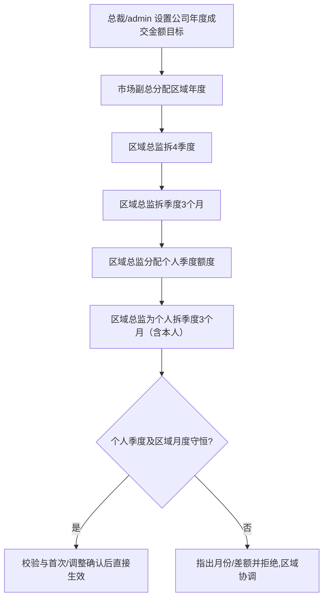
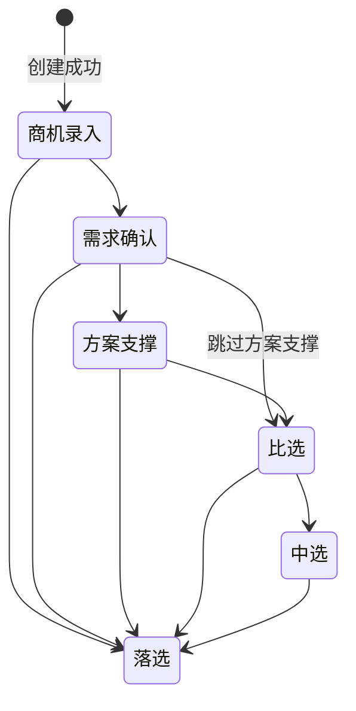
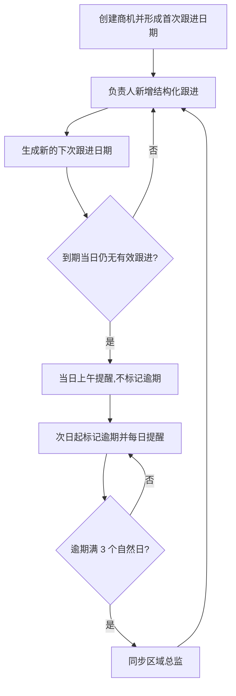
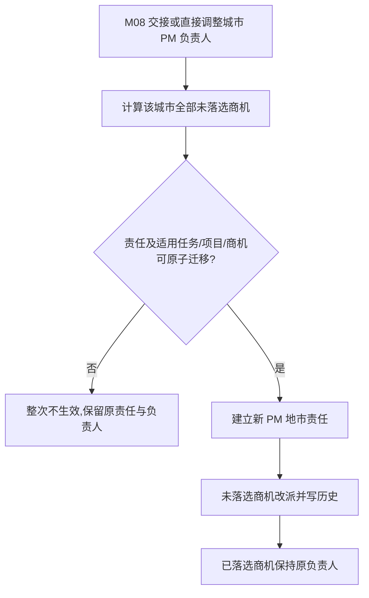

# FLOW-17：M12 销售与商机管理

- 状态：Current
- Owner：M12
- Decision：DEC-223（成交金额考核）、DEC-081、DEC-194、DEC-204、DEC-211（接收与文件交付）、DEC-210（支撑角色）、DEC-209（替代 DEC-206/208 的角色与地市责任部分）

## 工作台销售统计（DEC-222）

有权用户进入M01业务工作台 → 查看销售周期目标及当前快照 → 年/季/月筛选更新周期指标/趋势；商机概况选择运营中心、阶段/类型分析、联动条件、数量/金额 → 同一有权集合更新环形图/合计/分类占比。统计只读，不向商机列表传递条件；业务操作由销售管理首项“商机列表”和既有销售指标页进入。独立销售仪表盘取消，旧页面直接访问不再提供销售内容。精确规则见 `prd-workspace/current/modules/M12-sales-opportunity.md` §7 和 `prd-workspace/current/modules/M01-dashboard.md` §4.10。

按角色：总裁看公司达成/商机推进；副总看全国周期及区域达成；总监看主管区域，主周期同步本人业绩与各人完成、区域卡独立筛选；PM看本人目标/商机/趋势，取消本人跟进事项卡片，商机概况独占该行，跟进仍在既有商机详情维护；其余单独角色无销售区，admin业务原布局保持。精确集合与展示规则见 `prd-workspace/current/modules/M12-sales-opportunity.md` → §7.1.3。

## 销售目标建立

目标为成交金额（含税，元），按中选日期和中选成交金额计算完成；数量只作过程观察。总裁区域目标对比使用独立年/季/月和中心筛选，仅更新本卡；Owner完整口径见 `prd-workspace/current/modules/M12-sales-opportunity.md` → §6.1/6.2及§7.1.2。

当前流程依据 [`DEC-224`](../../decisions/DEC-224-销售目标年度逐级分配与个人拆月.md) → “2026-10-16 个人月份统一由区域总监分配”，完整规则见 `prd-workspace/current/modules/M12-sales-opportunity.md` → §4、§6.1/6.2/6.3。上级可先发布，下级未分配不补0；区域月度目标先定，个人不能改季度额度或区域月度。总裁/admin覆盖，副总区域年度，总监主管区域季度/月度及个人季度/月份协调，PM仅只读查看本人目标及业绩；分配弹窗显示实时余额并校验单项上限；首次免原因，点击确认分配校验后直接生效，修改已有目标仍需原因和二次确认；个人月度管理入口复用区域协调以分配或调整，精确余额/原因规则见上述Owner §6.3及AC-M12-57/58；历史月不改写，无审批/通知。公司与区域年度/季度按对应已分配目标读取，个人年度汇总季度。

## 商机创建、编辑与推进

有权用户查看商机列表 → 阶段后查看“是否方案支撑”和“交付进度”：有请求为是（含已关闭），无请求为否且进度—；进度为有效请求中当前已交付/验收关闭请求条数占有效请求条数，撤回/停止排除，零有效显示—但历史存在仍显示是，按请求不按人员/历次交付计数，进度只显示数字{x}/{y}而不带“已交付”前缀 → 继续通过原详情按钮办理；后续发起/补充/重交付/验收关闭后按当前请求事实更新两列。完整定义见 `prd-workspace/current/modules/M12-sales-opportunity.md` → §8.1“列表”；验收见 `prd-workspace/current/acceptance/M12.md` → AC-M12-64。

- “线索”只描述商机录入、需求确认等早期商机，不是独立对象或状态。
- 商机负责人按客户业务责任自动匹配并只读：市/区县客户匹配唯一地市 PM 负责人，省级客户匹配当前区域总监；无唯一有效匹配时阻止创建。
- PM 只可按本人当前 PM 责任地市创建本人负责商机；区域总监可创建并直接推进本人主管区域的省级商机，监管的其他商机只读监管，不可单独手工改派。
- 商机关键人从所选客户当前有效关键人中至少 1 人可搜索多选，保存时重新校验。
- 落选前仅允许编辑已确认字段；客户单位、商机类型不可改，负责人只随客户责任关系变化；中选后预估金额只读。成功编辑写入变更历史并更新最近更新时间。
- 进入中选填写中选日期、`成交金额（含税，元）`及说明/证明附件；中选仍允许跟进。
- 进入落选填写落选原因、竞争对手、复盘说明及证明附件；落选后停止推进和新增跟进。
- 当前 M12 不进入已签约；合同与财务能力须由未来独立 Current 产品链接管。

## 跟进

## 方案支撑

方案支撑由商机负责人向一名或多名在职、账号有效且具有商机支撑角色的员工发起（可与 PM 等兼任），按员工 ID 去重；每次必须填写支撑需求和交付截止时间，每名支撑人员独立经历待响应、进行中、已交付、已关闭。被指派人从`我的方案支撑`处理本人请求，可进入被指派商机的精简只读背景页，无 Tab 或支撑请求表格，按 M12 §10“支撑视角商机详情”展示；列表与详情可接收当前明确的待响应请求，先按 M12 §10“接收二次确认”弹窗核对，最终确认才进入进行中；取消或关闭不流转，失效/重复确认不写入；详情接收后停留原页且按钮消失；文件提交返回我的方案支撑，无过程提交；最终填写文件说明并上传1-9个附件，全部成功后成为已交付，负责人按 M12 §10“方案验收二次确认”核对后最终确认关闭，取消不流转、失效/重复不写入；admin 从`方案支撑管理`查看公司全量并以真实身份代操作，但不作为候选或受理人。不判断或发送回应超时消息，不展示回应超时；每条请求通过“历程”查看本人的独立支撑流程，权限沿用原请求范围，交付截止不引入新的逾期自动处理。

支撑列表按 M12 §10“支撑列表剩余时间与筛选”展示实时剩余时间；待响应/进行中按截止时间升序，超时未交付优先，已交付/已关闭置后。用户可按商机名称、客户单位、状态和交付截止日期范围组合筛选、重置；支撑接收、文件提交与权限沿用上述规则，不新增超时自动处理。

已交付内容不在支撑列表内铺开，通过操作栏“查看交付”打开最新交付的文件说明和附件列表，逐个查看或下载；补充中保留上次交付可查，新交付成功后整体更新，历次交付说明和附件在该请求“历程”中保留且可查看/下载。具体附件限制和失败原子性见 M12 §10“支撑文件”。

已交付 → 商机负责人点击“要求补充” → 弹窗填写必填“补充或修改说明” → 最终提交并复核 → 记录意见/操作人/时间、回到进行中 → 支撑人员在本人历程读取要求 → 重新提交说明与附件 → 已交付 → 负责人再次验收或要求补充 → 点击确认接收 → 二次确认弹窗核对商机与支撑人员/关闭后果 → 最终确认复核账号、权限、对象、指派、状态及本次交付 → 当前请求已关闭；取消不流转，失效/重复不写入。取消/空白/失权/重复提交不改变事实；原截止与历次成果保留，无新状态或消息。历程按记录时间倒序（最新在上，同时间按实际发生顺序倒序）独立展示每人的发起、接收、交付、补充、重新交付、关闭及附件，关闭保留来源上下文；完整交互及历史附件边界见 `prd-workspace/current/modules/M12-sales-opportunity.md` → §10“补充要求与支撑历程”、AC-M12-60/61/62。

## 销售指标查看

- PM通过`我的销售指标`只读查看本人季度及月度额度，不拆月或调整目标，继续查看本人月度成交金额目标、成交金额、差额、完成率和本人调整历史；不查看公司、其他区域或其他PM目标。
- PM 默认模板提供本人销售指标入口，按稳定员工 ID 展示一次。

## PM 地市责任变化

## 失败保护

- 必填缺失、范围变化、关键人失效或非法阶段请求不改变当前事实。
- 并发阶段请求只有基于最新版本的合法请求生效。
- 指标校验、权限或并发失败不覆盖最近生效版本。
- 消息失败不回滚商机、跟进或支撑事实。
- 越权访问统一返回 403 且不泄露对象是否存在。

## 本轮生命周期、目标调整与纠错（2026-10-14）

- 正常推进由负责人手动判断，可跳过方案支撑；进入中选/落选需材料及说明；错误事实由负责人通过“纠错”提交原因及材料，允许阶段退回/恢复落选、修改中选日期金额，重算业绩并保留历史。原主链只代表正常操作，落选不阻止纠错。准确入口见 M12 Owner §9及AC-M12-65/66。
- 公司已有年度目标调整 → 原设置入口填写新目标/原因并确认 → 本轮差额处理 → 副总/总监/个人沿授权链路保存待生效调整 → 受影响链路全部守恒且零余额 → 总裁/admin完成 → 公司/下级整体生效；完成前统计读旧值。取消二次确认后全部未生效内容作废；同年下一轮只能在完成/取消后开始。初次分配与其他独立调整仍按§6.2，当前公司差额过程替代上方即时生效路径；准确入口 M12 §6.4及AC-M12-69/70/71。
- 支撑待响应可撤回；负责人/admin主动停止需原因及二次确认；落选关闭全部未关闭支撑，原因商机落选；关闭/撤回后如需新增请求。停用管理者指定有效接替人 → 确认前复核全部接替人 → 账号先停用 → 系统自动交接原请求且保留文件/状态/完整历程；缺接替阻止提交，后续交接失败账号仍停用、成功项保留、失败项继续处理。准确入口 M12 §10、M06“员工停用”及AC-M12-67/68。

## 交接异常与目标承接（2026-10-15）

- 移除支撑角色 → 复核全部未关闭请求与接替人及唯一性 → 原请求交接成功 → 撤销角色；失败全部保持。新增支撑也校验同商机同员工未关闭唯一性。
- 原负责人已失效/不匹配的落选恢复 → admin上传材料说明 → 匹配客户当前唯一有效PM/总监 → 同次恢复及责任记录；无匹配阻断。
- 停用/实际交出某区域全部责任 → 从实际接替人指定一人承接个人目标 → 本月未完成差额/未来已分配全额，季月守恒 → 目标随对应责任成功生效 → 领导原个人季度入口可联合协调季/月；部分地市交接不自动转目标。历史目标及原中选归属保持。完整规则M12 §6.5及AC-M12-72至77。

## 销售复盘确认补充（2026-10-15）

- 销售开始前由管理流程完成商机所属区域当年全链目标拆分（年度→区域→季度/月度→个人季度/月度），无需其他区域全部完成；不新增系统业务入口拦截，原目标/交接/历史月校验保持。见 `prd-workspace/current/modules/M12-sales-opportunity.md` → §6.2，AC-M12-78。
- 员工目标已转出且停用 → 该季个人额度为0的原空月保持未分配 → 后续公司调整不强制补0 → 其他有效链路完整且全层守恒才整体生效；不能向停用人员新增额度。见 `prd-workspace/current/modules/M12-sales-opportunity.md` → §6.4，AC-M12-79。
- 真实中选后落选 → 负责人/admin纠错 → 保持落选，填写正确原中选日期/金额及材料说明 → 原事件归属不变、历史不覆盖、阶段时间不重置 → 相关周期业绩重算；从未中选不新增事件。见 `prd-workspace/current/modules/M12-sales-opportunity.md` → §9“商机纠错”，AC-M12-80。

## 平台师资合作商机与无关键人

生态员进入新建商机 → 类型固定平台师资合作、负责人本人 → 选择正常平台公司（不取PM客户表），不维护关键人；平台停用只退出新建候选、已有商机仍可维护；admin代建先选该类型及有效生态员。普通培训/AI商机若客户无有效关键人，有M02原创建权限者打开客户固定的创建表单 → 成功返回保留草稿并刷新候选；无权限者联系客户负责人或管理员补充，再选择关键人。提交复核类型/对应客户源/当前员工与负责人，关键人仅校验普通类型 → 原商机录入阶段。本人沿既有跟进/支撑/推进；中选事件仅计公司。地区交接排除此类型；生态停用/撤角色通过原员工入口与项目共用接替人交接未落选商机。详见M12“平台师资合作商机”及DEC-227“当前决定”。
